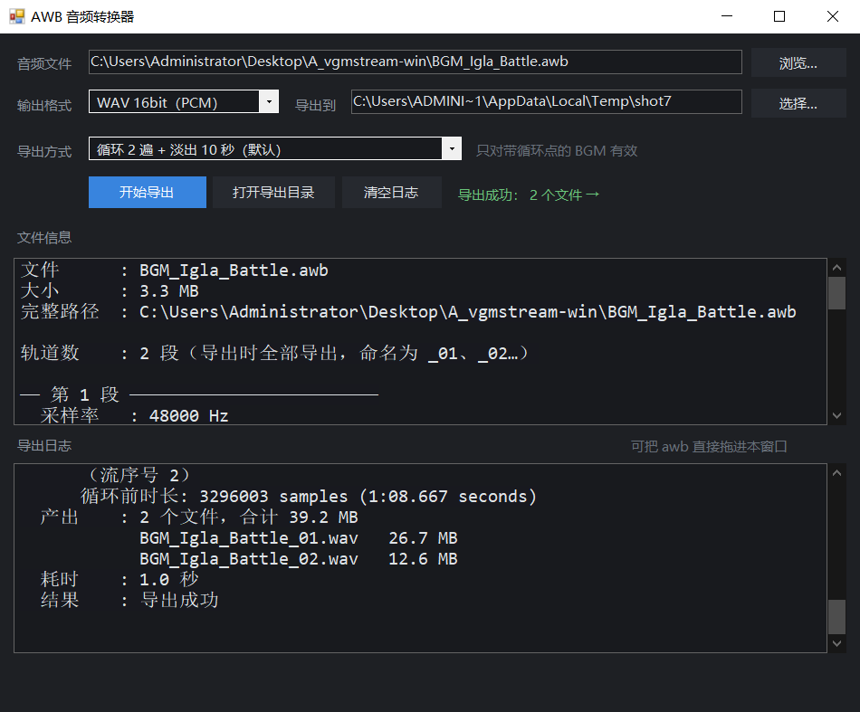

# AWB 音频转换器

> 一个把游戏音频包（`.awb` 等）批量导出成 `.wav` 的 Windows 小工具，深色界面、单文件、开箱即用。

最初是给自己导出《少女前线2：追放》的 音频 用的。这游戏的 `.awb` 经常**把一个音频包塞进两段甚至多段轨道**，直接把文件拖给 `vgmstream-cli.exe` 只会导出第一段，剩下全丢了 —— 这个工具就是为解决这个问题写的。

<p align="center">
  
</p>

---

## 功能

- **多轨全导出**：一个 `.awb` 里有多少段轨道就导出多少段，自动命名为 `名字_01.wav`、`名字_02.wav`……
- **两种输出格式**：`WAV 16bit（PCM，体积小）` / `WAV 32bit（float，原始数据无损）`
- **中文UI**：逐段显示采样率、声道、编码格式、比特率、循环起止点、原始时长、导出时长、轨道名
- **日志**：解码命令、每段参数、产出清单、耗时、结果，全部中文化
- **单文件运行**：vgmstream 全部打包在 exe 内部，拷走一个文件就能用，无需安装
- **支持拖入**：把文件直接拖进窗口也行

## 快速开始（普通用户）

1. 到 [Releases](../../releases) 下载 `AWB转换器.exe` 和 `AWB转换器.exe.config`
   > ⚠️ **两个文件必须放在同一个目录**。`.config` 是高 DPI 支持所需的配置，缺了它文字会发虚。
2. 双击 `AWB转换器.exe`
3. 点「浏览…」选择音频文件（或直接把它拖进窗口）
4. 选输出格式 → 选导出目录 → 点「开始导出」

首次启动会在 exe 同级目录解压出 `AWB转换器_工具_<指纹>` 文件夹（约 10.7 MB，13 个文件），这是 vgmstream 的运行库，**不要删**。之后启动会直接复用。

导出结果会放在 `<你选的目录>\<文件名>\` 里，一圈一个：

```
AWB导出\
└── BGM_Igla_Battle\
    ├── BGM_Igla_Battle_01.wav   （第 1 段）
    └── BGM_Igla_Battle_02.wav   （第 2 段）
```

## 常见问题

**Q：为什么没有 MP3 / FLAC？**
vgmstream 只能输出 wav，要转 MP3/FLAC 必须再带一个编码器（ffmpeg 静态版约 80 MB）。为了保持体积，目前只做 wav。如果你需要，可以自己拿导出的 wav 转。

**Q：导出的文件为什么比原音频长很多？**
因为 BGM 带循环点。默认按「循环 2 遍 + 淡出 10 秒」导出（vgmstream 的默认行为），这样听感是完整的。面板里会分别显示「原始时长」和「导出时长」。

**Q：能批量转换吗？**
目前一次一个文件，批量功能在计划中。不过基于vgmstream-cli的批量导出脚本已经实现了后续再合并进来吧

**Q：exe 上报毒？**
没有签名的小工具经常会被杀软/浏览器误报。源码就在 `src/` 里，只有 660 行 C#，自己审阅并自行编译。

---

## 构建（开发者）

### 依赖

- Windows 7 及以上
- **.NET Framework 4.x**（Windows 10/11 自带，含 `csc.exe`）
- 不需要安装 Visual Studio、不需要 .NET SDK

### 步骤

```powershell
git clone https://github.com/<你的用户名>/AWB-Converter.git
cd AWB-Converter
powershell -NoProfile -ExecutionPolicy Bypass -File src\build.ps1
```

构建脚本会：

1. 校验 `tools\` 里的 13 个 vgmstream 文件
2. 把它们打包成内嵌资源 `src\awbtools.bin`（自定义二进制格式，见下）
3. 用 `csc.exe` 编译出 `dist\AWB转换器.exe`（含图标、清单）
4. 复制 `app.config` → `dist\AWB转换器.exe.config`

> 如果你要替换 vgmstream 版本，只需把新的 `vgmstream-cli.exe` 和配套 DLL 放进 `tools\` 再重新构建。内嵌资源带 SHA-256 指纹，换了文件会自动使用新的缓存目录，不会和旧版本冲突。

### 项目结构

```
AWB-Converter/
├── src/
│   ├── Program.cs        主程序（C#，WinForms，约 660 行）
│   ├── build.ps1         一键构建脚本
│   ├── app.manifest      DPI 感知 + Win10 兼容性声明
│   ├── app.config        高 DPI 支持（会复制成 exe.config）
│   └── app.ico           程序图标
├── tools/                vgmstream-cli 及其依赖（随仓库分发，保证可复现构建）
│   ├── vgmstream-cli.exe
│   ├── *.dll
│   └── vgmstream-COPYING.txt
├── docs/
│   ├── README.en.md      英文说明
│   └── vgmstream-README.md
└── dist/                 构建产物（已 gitignore）
```

### 内嵌资源格式

为了让单个 exe 自带全部运行库，`build.ps1` 会把文件按下面的格式拼成一个 `awbtools.bin`，再用 `/resource:` 嵌进 exe；程序启动时解析、校验、解压到缓存目录：

| 偏移 | 类型 | 内容 |
|---|---|---|
| 0 | `uint32` | 魔数 `0x31574241`（ASCII `ABW1`） |
| 4 | `int32` | 文件个数 N |
| 8 | … | 重复 N 次：`int32` 文件名长度、UTF-8 文件名、`int32` 数据长度、数据 |

解压目标按优先级依次尝试：exe 同级目录 → `%LOCALAPPDATA%\AWBConverter\tools_<指纹>` → `%TEMP%`。目录名里的指纹是资源包的 SHA-256 前 16 位，所以升级工具后不会用到旧缓存。


---

## 路线图

- [ ] MP3 / FLAC 输出（需要内嵌编码器，体积会明显增加）
- [ ] 批量导出（一次选多个文件 / 指定文件夹递归）
- [ ] 输出采样率、位深可选
- [x] 自定义循环遍数与淡出时长
- [x] 深色界面
- [x] 高 DPI 支持

## 致谢

- **解码核心**：[vgmstream](https://github.com/vgmstream/vgmstream)（r2117）—— 所有格式解析与解码都由它完成，本仓库只是给它套了个中文界面和批量流程。
  - vgmstream 自身代码：**ISC 风格宽松许可**（允许任意使用、修改、分发，保留版权声明即可），版权归 vgmstream 项目及其贡献者所有，全文见 `tools/vgmstream-COPYING.txt`。
  - 其中 `avcodec` / `avformat` / `avutil` / `swresample` 这 4 个 DLL 来自 **FFmpeg**，采用 **LGPL-2.1**，重新分发时需保留其许可说明。
  - 打包与分发说明见 `tools/vgmstream-LICENSE.txt`。
  - 感谢《少女前线2：追放》的音频设计（以及那些把两段 BGM 塞进一个包里的奇怪打包习惯困扰我好久，没有它就没有这个工具）。

## 许可

- **本仓库源码**（`src/` 及文档）：[MIT](LICENSE)
- **`tools/` 目录下的 vgmstream 相关文件**：vgmstream 自身代码为 **ISC 风格宽松许可**（版权归 vgmstream 项目及贡献者，全文见 `tools/vgmstream-COPYING.txt`）；其中 4 个 `av*` / `swresample` DLL 来自 FFmpeg，为 **LGPL-2.1**。重新分发时必须保留这些许可文件。详见 `tools/vgmstream-LICENSE.txt`。

本工具只做格式转换，不包含任何游戏资源，也不提供下载渠道。请自行确认使用场景合法。

---

**English**: [docs/README.en.md](docs/README.en.md)
